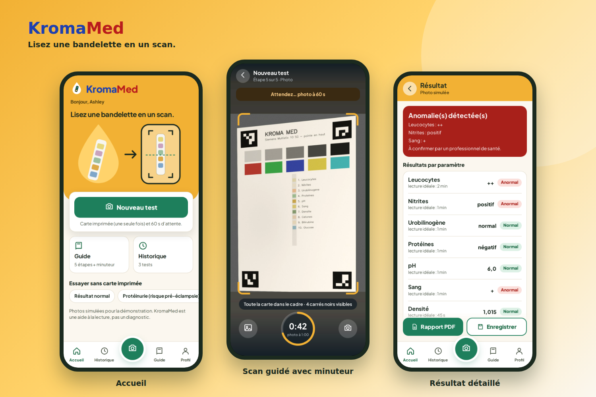
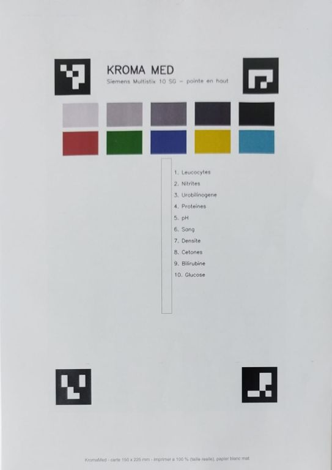

# KromaMed — application mobile + API + moteur de vision (Livraisons 1 à 4)

Lecture colorimétrique de bandelettes urinaires à partir d'une simple photo de smartphone.
Ce dépôt contient le **moteur de vision en Python/OpenCV** : il redresse la photo, corrige la lumière
et les couleurs grâce à une carte d'étalonnage imprimée, lit chaque plage réactive et **refuse
d'analyser** si la photo n'est pas assez fiable (seuil 85 %).

**Application en ligne : <https://kromamed.onrender.com/>** · **Démo vidéo : <https://youtube.com/shorts/907lXo1E15M>** · **Fiche technique : [docs/FICHE_TECHNIQUE.pdf](docs/FICHE_TECHNIQUE.pdf)**

> **État honnête du projet** : validé sur 100 photos **simulées** (700/700 plages correctes, cas
> dégradés refusés). Pas encore validé sur de vraies photos ni cliniquement. Voir « Limites » plus bas.
> KromaMed est une aide à la lecture, pas un diagnostic.

## Application mobile (installable sur téléphone)


Écrans : **Accueil**, **Nouveau test** (préparation, caméra, minuteur de 60 s), **Résultat**, **Historique**, **Guide**, **Profil**
(nom, à propos, sauvegarde/restauration, suppression des tests, photo de test pour le réglage).
Ouvrez l'adresse du site sur un téléphone, puis « Ajouter à l'écran d'accueil » : elle s'installe comme une application.
Voir `docs/TESTER_SUR_TELEPHONE.md`. Captures d'écran : `docs/img/`.

## Pourquoi une carte imprimée ?
La même bandelette n'a pas la même couleur au soleil, sous une ampoule jaune ou à l'ombre. La carte (4 repères noirs, des
carrés de gris et de couleur, du papier blanc) est vue **dans la même photo** que la bandelette : le papier blanc sert de
référence pour corriger la lumière, et les repères servent à redresser l'image. **Elle s'imprime une seule fois et se réutilise.**
Sans référence physique dans la photo, une lecture fiable n'est pas possible : un « mode sans carte » est une piste future
(par exemple une carte fournie dans la boîte de bandelettes, ou la bande d'identification de la bandelette elle-même).

### Test avec une vraie carte imprimée


Cette photo réelle (imprimante de bureau, lumière de pièce) a révélé que les couleurs imprimées sont très éloignées des
couleurs « idéales » (un vert sort 4 fois plus sombre). L'étalonnage a donc été refait : **le papier blanc est la référence**,
et les couleurs imprimées ne servent plus qu'à des contrôles. La photo est conservée comme test automatique
(`tests/test_pipeline.py::test_vraie_carte_imprimee_photographiee`). Une carte **vide** (sans bandelette) est refusée
(« aucune bandelette détectée ») au lieu d'être lue comme un résultat normal.

## 1. Ouvrir dans VS Code
1. Dézipper le dossier, puis dans VS Code : **Fichier → Ouvrir le dossier…** → `kromamed-vision`.
2. Installer l'extension **Python** (Microsoft) si VS Code la propose.
3. Ouvrir le terminal : **Terminal → Nouveau terminal**, puis :

```bash
# Windows (PowerShell)
python -m venv .venv
.venv\Scripts\Activate.ps1
# macOS / Linux
# python3 -m venv .venv && source .venv/bin/activate

pip install -r requirements.txt
```
Si Windows bloque l'activation : `Set-ExecutionPolicy -Scope CurrentUser RemoteSigned`.
Dans VS Code, choisir l'interpréteur `.venv` (barre du bas, ou `Ctrl+Maj+P` → *Python: Select Interpreter*).

## 2. Utiliser
```bash
python scripts/make_demo.py                         # crée une photo simulée de démonstration
python scripts/run.py data/demo/photo_demo.png      # analyse -> out/resultat.json + images annotées
python scripts/benchmark.py                         # 100 photos simulées + cas à refuser
python scripts/make_card.py                         # carte d'étalonnage à imprimer (out/carte_etalonnage.png)
pytest -q                                           # 38 tests automatiques (moteur + API + application)
```
Pour analyser **votre propre photo** : `python scripts/run.py chemin/vers/photo.jpg`
(la photo doit montrer la carte imprimée avec ses 4 repères noirs et la bandelette posée dans sa fente).

**Livraison 3 :** 10 paramètres (Multistix 10 SG), minuteur, rapport PDF, historique + export Excel.
Avant d'imprimer la carte : `docs/MESURES_BANDELETTE.md`. Protocole et temps de lecture : `docs/PROTOCOLE.md`.

### Lancer la démo web en local (Livraison 2)
```bash
python -m uvicorn api.main:app --reload
```
Puis ouvrir **http://127.0.0.1:8000** (page de démo) et **http://127.0.0.1:8000/docs** (documentation de l'API).
Arrêter le serveur : `Ctrl+C`. Mise en ligne : voir `docs/DEPLOIEMENT.md`.

## 3. Mettre sur GitHub
1. Créer un compte sur github.com, puis **New repository** → nom `kromamed` → laisser vide (sans README) → Create.
2. Dans le terminal VS Code, à la racine du projet :
```bash
git init
git add .
git commit -m "Moteur de vision KromaMed (Phase 1)"
git branch -M main
git remote add origin https://github.com/VOTRE-NOM/kromamed.git
git push -u origin main
```
Au premier `push`, GitHub demande de s'authentifier (fenêtre du navigateur ou *Personal Access Token*).
Ensuite, après chaque livraison : `git add . && git commit -m "message" && git push`.

## 4. Limites connues (à dire clairement)
- Les teintes de `config.REFERENCE_TABLE` sont des **valeurs de démonstration**, pas celles d'un fabricant.
- Les seuils de qualité (netteté, éclairage) sont calibrés sur des images simulées : à recalibrer sur de vraies photos.
- Les couleurs de la carte sont supposées parfaites ; une carte imprimée réelle doit être mesurée.
- Le temps affiché est celui d'un PC en Python, pas d'un téléphone.

## 5. API
| Route | Rôle |
|---|---|
| `GET /` | l'application mobile (+ `/manifest.webmanifest`, `/sw.js` pour l'installation) |
| `GET /api/scenarios`, `GET /api/demo/{id}` | photos simulées analysées (dont cas à refuser) |
| `POST /api/analyze` | envoyer une photo (champ `file`) → résultat JSON + images annotées |
| `POST /api/report` | rapport PDF (le navigateur renvoie le résultat ; rien n'est stocké) |
| `POST /api/history/xlsx` | Excel de l'historique (colonnes de `base_donnees_tests.xlsx`) |
| `GET /api/health` | vérification pour l'hébergeur |

Les photos sont traitées en mémoire et jamais enregistrées.

## 6. Structure
Voir `docs/EXPLICATIONS.md` (explication simple de chaque fichier) et `docs/Feuille_de_Route_Technique_KromaMed.pdf`.
Identité visuelle retenue : `assets/brand/` (version « goutte »).
